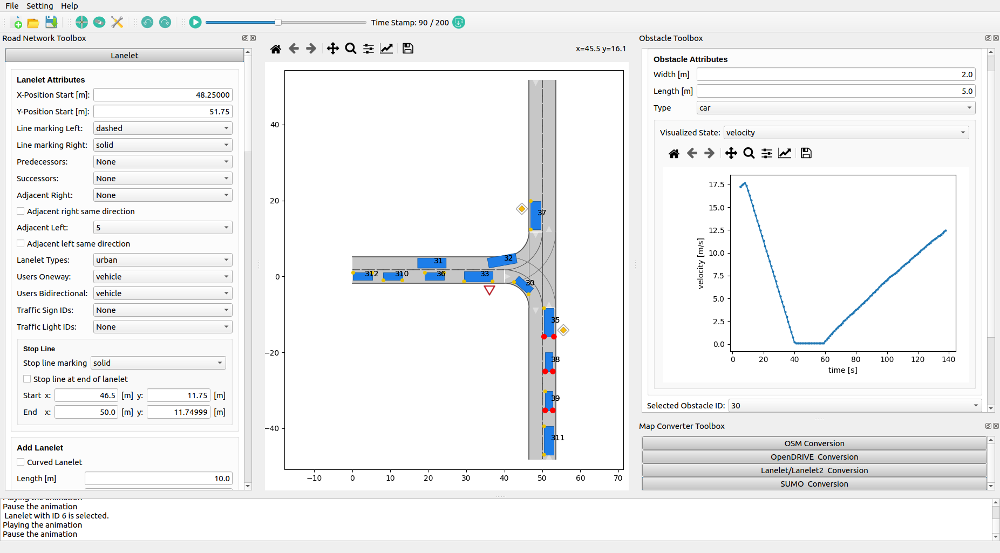

# Inverted AI map converter

Converts an OpenDRIVE (`.xodr`) map into the files [TorchDriveSim](https://github.com/inverted-ai/torchdrivesim)
and the Inverted AI API consume: a Lanelet2 map, traffic-control stoplines, a road mesh, map metadata and a
top-down picture. It also includes tools that generate traffic-light state machines and that measure
conversions across many maps.

This repository is a fork of [CommonRoad Scenario Designer](https://github.com/CommonRoad/commonroad-scenario-designer)
v0.8.5; the upstream documentation follows [below](#commonroad-scenario-designer).

## Setup

Linux x86_64, Python 3.10–3.13. The converter runs from a clone; it is **not** pip-installable and is never
installed into the environment.

```bash
git clone https://github.com/inverted-ai/map-converter.git /path/to/map-converter
python3 -m venv /path/to/map-converter/.venv
/path/to/map-converter/.venv/bin/pip install -r /path/to/map-converter/requirements.txt
```

Use `requirements-tests.txt` instead to also run the tests. Run every tool with the venv's Python and the
script's absolute path, from any directory:

```bash
/path/to/map-converter/.venv/bin/python /path/to/map-converter/convert_map.py dir_path=/path/to/maps/MyMap
```

Notes:
- `torchdrivesim` is installed from a pinned GitHub commit: the converter needs a version newer than the
  latest PyPI release.
- The PyPI `torch` wheel is built for a recent CUDA. On a machine whose GPU driver is older, the converter
  prints a CUDA warning and renders on the CPU; the outputs are the same.
- If your shell sets `PYTHONPATH` (for example by sourcing ROS), unset it for these tools.

## Converting a map

`convert_map.py` takes [OmegaConf dotlist](https://omegaconf.readthedocs.io/en/latest/usage.html#from-a-dot-list)
arguments, each a field of `MapConversionConfig`:

```bash
/path/to/map-converter/.venv/bin/python /path/to/map-converter/convert_map.py \
    dir_path=/path/to/maps/MyMap domain=carla center='[100.0,-20.0]' trim_radius=300
```

`dir_path` must contain exactly one `.xodr`; its file name (without `.xodr`) becomes the map name `<map>`.
All outputs are written into `dir_path`. Alternatively give the file itself as `xodr_path=/path/to/MyMap.xodr`:
the outputs then go to `/path/to/MyMap/`, so several `.xodr` files in one folder never overwrite each other.
From Python, `convert_map.convert_map(MapConversionConfig(xodr_path=...))` returns the absolute `.osm` path.
The configuration is checked before anything is read: neither or both of `dir_path` and `xodr_path`, no or
several `.xodr` files, or `trim_radius` without `center`, stop the run with exit code 3 and write nothing.

| Field | Default | Meaning |
|---|---|---|
| `dir_path` | unset | Directory holding exactly one `.xodr`; all outputs are written here. |
| `xodr_path` | unset | The `.xodr` itself, instead of `dir_path`; outputs go to `<xodr folder>/<map>/`. Exactly one of the two is required. |
| `domain` | unset | Prefix for `iai_location_name` in `metadata.json` (`<domain>:<map>`); unset leaves it null. |
| `lane_marking_join_threshold` | `0.1` | Distance (m) under which the markings of two neighbouring lanes are drawn as one line in the mesh. |
| `visualization_fov` | unset | Width (m) of the square area `visualization.png` shows, centred on `center`. Unset fits the whole road mesh with a 5% margin; the value used is recorded in `<map>_provenance.json`. |
| `center` | unset | Map centre `[x, y]` in local metres: written to `metadata.json`, used as the render and trim centre. Unset uses the mesh centre. |
| `trim_radius` | unset | Keep only lanelets and stoplines within this many metres of `center` (requires `center`). |
| `trim_vertical_limits` | unset | `[min_z, max_z]`: stoplines outside the band are dropped; with `trim_radius`, lanelet points outside it are trimmed too. |
| `simplify_tolerance` | `0.2` | Maximum lateral error (m) of the Douglas-Peucker simplification of lanelet boundaries; `0` disables it. |
| `osm_target_bytes` | `1048576000` | Size budget for the `.osm`: the tolerance widens until the file fits, and the run fails if it never does. Unset disables the budget. |
| `simplify_max_iterations` | `1` | Attempts at fitting the size budget. |
| `simplify_tolerance_factor` | `2.0` | Factor the tolerance grows by per attempt. |
| `allow_zero_origin` | `false` | Convert a map whose `<geoReference>` is present but unusable at latitude/longitude (0, 0) instead of failing. (A map with no `<geoReference>` always converts at (0, 0), with a warning.) |
| `verifier_timeout_s` | `300` | Cap in seconds on the CommonRoad map verifier the validation stage runs (see "Validation" below); `0` skips it. A run that reaches the cap records `timeout` and carries on. |

## Output files

| File | Contents | Read by |
|---|---|---|
| `<map>.osm` | Lanelet2 map: lanelets, boundary line strings with marking types, traffic-light and sign line strings | TorchDriveSim (`MapConfig.lanelet_map`), routing |
| `<map>_stoplines.json` | List of `Stopline` rows: `actor_id` (OpenDRIVE signal/object id), `agent_type` (`traffic_light`, `stop_sign` or `yield_sign`), `x`, `y` (local metres), `length`, `width`, `orientation` (radians) | TorchDriveSim traffic controls; `traffic_light_fsm.py` |
| `<map>_mesh.json` | Road and lane-marking `BirdviewMesh`: `verts`, `faces`, `categories`, `vert_category`, `colors`, `zs` | TorchDriveSim rendering |
| `metadata.json` | `MapConfig`: `name`, `center`, `lanelet_map_origin` (lat, lon), `left_handed_coordinates`, the three file names above, `traffic_light_controller_path`, `iai_location_name` | `torchdrivesim.map.load_map_config` |
| `visualization.png` | 2048×2048 top-down render centred on `center`, `visualization_fov` metres wide | People |
| `<map>_signal_groups.json` | Traffic-light structure the OpenDRIVE file declares: junction per signal id (`membership`, with the source it came from), `<controller>` groups and `sequence`, conflicts, non-integer ids | `traffic_light_fsm.py` |
| `<map>_provenance.json` | What produced the outputs: input path and sha256, the full `MapConversionConfig`, converter git commit and dirty flag (`null` outside a git checkout), the visualization FOV used, the traffic side of the roads (`RHT`, `LHT` or `mixed`), Python and package versions, UTC time | People, `map_report.py` |
| `<map>_conversion_report.json` | Everything in the input the converter could not use as written, and what it did instead (see below). Written even when the conversion fails, once the input file is known | People |

`metadata.json` must stay loadable by `MapConfig(**json)`, which rejects unknown keys, so extra information is
written to separate sidecar files.

### The conversion report

The converter keeps going past input it cannot use as written: it falls back to a default, drops the smallest
element affected, and records it. `<map>_conversion_report.json` holds:

1. `outcome` (`ok` or `failed`) and `error` (exception type and message) for a failed run; `validation`, the
   validation verdict (below), for a successful one.
2. `elements`: per OpenDRIVE element (`road`, `geometry`, `lane`, `width`, `signal`, `object`, ...), how many
   the file holds (`seen`), how many were `dropped`, `converted` (seen minus dropped) and `degraded` (kept
   with a changed attribute).
3. `unrecognised_tokens`: each unknown value (`element`, `value`), how often it occurred and the ids where
   (up to 20).
4. `records_by_kind` and `records`: every record, with `kind`, `element` (`<tag>` when the element was
   dropped, else `<tag>.<attribute>`), `id` (road, signal, object or junction), `value`, `action` and the
   message. Each record is also printed as a warning, once per `kind`, `element` and `value`.

| `kind` | Example | What the converter does |
|---|---|---|
| `decimal_comma` | `length="29,7"` | Reads it as `29.7`; one record per attribute with the count |
| `unparseable_number` | `<width a="wide">` | Drops that record (geometry, width, border, elevation, lateral-profile or lane-offset record, speed, access); a road, signal, object or junction whose own id or required numbers do not parse is dropped whole |
| `unknown_value` | lane `type="fastLane"`, object type, signal `country="GBR"`, road-mark `type="custom"`, connection `contactPoint="none"`, unknown geometry type | Lane and object type `none`; country `ZAM` sign tables; marking unknown; connection or geometry record skipped |
| `missing_attribute` | signal without `dynamic`, speed without `unit` | `dynamic="no"`, orientation `none`; the speed is left unset |
| `coerced` | object `type="stopline"` | Read as `roadMark` |
| `degenerate_geometry` | `<spiral>` with equal start and end curvature | Read as an arc (a line at zero curvature) |
| `unknown_reference` | signal `<validity>` naming a lane that does not exist | That lane is skipped |

### Validation

After writing the outputs, the converter checks them and stores the verdict under `validation` in the
conversion report. Every number comes from `map_quality.py` (the same metrics `map_report.py` records); the
thresholds are in `map_validation.ValidationConfig`. They are proposals from the test corpus and are not yet
ratified, so a failed check prints a `Validation:` warning and sets `status` to `warn`; the conversion still
succeeds.

| Check | Fails when |
|---|---|
| `has_lanelets` | the `.osm` has no lanelets |
| `routing_edge_pct` | fewer than 95% of lanelets have a predecessor, successor or neighbour in the routing graph |
| `seam_handshake_pct` | fewer than 95% of the lanelet ends that meet share their nodes |
| `crossed_fraction` | more than 2% of lanelets have an outline that folds or touches itself |
| `traffic_light_stoplines` | the `.osm` has traffic-light ways but no traffic-light stoplines were written |
| `stop_yield_stoplines` | the `.osm` has stop or yield sign ways (subtype `…206`/`…205`) but no stop/yield stoplines |
| `lanelets_without_subtype` | any lanelet lacks a `subtype` |
| `point_extent_m` | a point lies more than 20 km from the local origin |
| `origin_in_range` | `lanelet_map_origin` is not a valid latitude/longitude |

`verifier` holds the result of CommonRoad's map verifier (all formulas, report-only, never repairing): `status`
(`ok`, `timeout`, `error` or `skipped`), whether the map was `partitioned` (above 200 lanelets), the run time,
and per formula the number of invalid states with up to five example element ids. It runs in a separate
process killed at `verifier_timeout_s`.

Coordinates: one local frame in metres for every output: the file's coordinates plus the header `<offset>`
shift, minus the map centre for `utm` maps and for `tmerc` maps with a false easting/northing (which keeps
coordinates small enough for the float32 mesh). `lanelet_map_origin` is the latitude and longitude that
frame's origin maps to (Lanelet2 `UtmProjector`).

## Traffic-light state machines

`traffic_light_fsm.py` reads a converted map directory, groups traffic-light stoplines into intersections and
phase groups, and writes `<map>_traffic_light_controller.json` (one looping state list per intersection). It
also adds `traffic_light_controller_path` to `metadata.json`.

How much of the OpenDRIVE file's own traffic-light structure it uses is configurable; each level adds to the one
before, and enabling a level turns on the ones it builds on:

| Level | Flag | Default | Taken from the OpenDRIVE file | Generated by the tool |
|---|---|---|---|---|
| A | `--xodr-junctions` / `--no-xodr-junctions` | on | which lights form one intersection (each junction's lights stay together; two junctions are never merged) | phase groups (direction split) and their order |
| B | `--xodr-groups` | off | also the phase groups: one `<controller>` = one phase | phase order |
| C | `--xodr-sequence` | off | also the phase order (controller `sequence`) | timings only |

Junction membership comes from `<map>_signal_groups.json` (written by `convert_map.py`; `--signal-groups` points
elsewhere). Without it, or with level A off, lights are clustered by distance only. Lights no junction claims are
clustered by distance and may join a nearby junction's intersection; they are listed in the log. An intersection
lacking data for the requested level uses the next lower one.

It also writes `<map>_fsm_review.json`: per intersection, its junction, the level actually used, its lights and
phase groups, and how certain the grouping is, plus the lights no junction claims and `stopline_join`: whether
every traffic-light `actor_id` in the stoplines appears in exactly one FSM and the FSMs name no other actor
(`missing_from_fsm`, `not_in_stoplines`, `in_several_intersections`, `ok`). `certainty` is the lower of two
parts in [0, 1]:

1. `spatial`: distance to the nearest other intersection, divided by twice `--cluster-eps` (1.0 when an XODR
   junction declares the membership).
2. `axis`: how cleanly the two phase groups' stopline directions separate (1.0 for one group, or when XODR
   controllers declare the groups).

`reason` names the limiting part (`spatial` or `axis`), or is `clear` (1.0) or `declared` (levels B and C).
`topology_refined` marks intersections split by lanelet topology. `flagged` lists the intersections below
`--review-threshold` (default 0.7) for a human to check. The controller file is unchanged.

To add `<map>_signal_groups.json` to a map converted before this file existed:

```bash
/path/to/map-converter/.venv/bin/python /path/to/map-converter/opendrive_signal_groups.py \
    --xodr /path/to/maps/MyMap/MyMap.xodr --out /path/to/maps/MyMap/MyMap_signal_groups.json
```

```bash
/path/to/map-converter/.venv/bin/python /path/to/map-converter/traffic_light_fsm.py /path/to/maps/MyMap
```

```text
usage: traffic_light_fsm.py [-h] [--cluster-eps CLUSTER_EPS]
                            [--axis-split-threshold AXIS_SPLIT_THRESHOLD]
                            [--green-base GREEN_BASE]
                            [--green-per-extra-lane GREEN_PER_EXTRA_LANE] [--green-min GREEN_MIN]
                            [--green-max GREEN_MAX] [--yellow YELLOW] [--all-red ALL_RED]
                            [--certainty-threshold CERTAINTY_THRESHOLD]
                            [--review-threshold REVIEW_THRESHOLD]
                            [--topology-max-hops TOPOLOGY_MAX_HOPS] [--no-topology]
                            [--xodr-junctions | --no-xodr-junctions]
                            [--xodr-groups | --no-xodr-groups]
                            [--xodr-sequence | --no-xodr-sequence] [--signal-groups SIGNAL_GROUPS]
                            [--visualize] [--px-per-m PX_PER_M] [--max-mosaic-px MAX_MOSAIC_PX]
                            map_dir

Auto-generate traffic-light finite state machines (FSMs) from converted-map artifacts. This is a
standalone tool. Given a map directory containing ``metadata.json``, a Lanelet2 ``.osm`` and a
``*_stoplines.json`` (the artifacts produced by ``convert_map.py``), it clusters traffic-light
stoplines into intersections, splits each intersection into at most two phase groups, and emits a
per-intersection FSM in the format consumed by the IAI stack (see
``maps/Carla_UE4_old/Town15/carla_Town15_light_group_states.json``). The tool never relies on
OpenDRIVE, CommonRoad, or traffic-light positions: ``actor_id`` is treated as an opaque grouping
key already present in ``stoplines.json``, and the only geometry it trusts is the stoplines
themselves. Two strategies are combined: * Geometry (always): cluster by position, sub-group by
stopline axis (orientation mod pi). * Topology (only where geometry is uncertain): associate
stoplines to lanelets in the ``.osm`` and use lane connectivity/adjacency to correct the geometric
guess. Run with ``python traffic_light_fsm.py <map-dir>``.

positional arguments:
  map_dir               Map directory with metadata.json, .osm and *_stoplines.json

options:
  -h, --help            show this help message and exit
  --cluster-eps CLUSTER_EPS
  --axis-split-threshold AXIS_SPLIT_THRESHOLD
  --green-base GREEN_BASE
  --green-per-extra-lane GREEN_PER_EXTRA_LANE
  --green-min GREEN_MIN
  --green-max GREEN_MAX
  --yellow YELLOW
  --all-red ALL_RED
  --certainty-threshold CERTAINTY_THRESHOLD
  --review-threshold REVIEW_THRESHOLD
                        Flag intersections below this certainty in <map>_fsm_review.json
  --topology-max-hops TOPOLOGY_MAX_HOPS
  --no-topology         Disable lanelet topology refinement
  --xodr-junctions, --no-xodr-junctions
                        Keep each XODR junction's lights in one intersection (default on)
                        (default: True)
  --xodr-groups, --no-xodr-groups
                        Also take phase groups from XODR controllers (implies --xodr-junctions)
                        (default: False)
  --xodr-sequence, --no-xodr-sequence
                        Also order phases by controller sequence (implies --xodr-groups) (default:
                        False)
  --signal-groups SIGNAL_GROUPS
                        Signal groups JSON (default: <map>_signal_groups.json beside the
                        stoplines)
  --visualize           Also render a birdview mosaic with intersections/subgroups overlaid
  --px-per-m PX_PER_M   Visualization pixels per metre (default from VizConfig; only used with
                        --visualize)
  --max-mosaic-px MAX_MOSAIC_PX
                        Visualization max image dimension in pixels (default from VizConfig)
```

`fsm_visualization.py` renders the whole map to `<map>_fsm_visualization.png` with each intersection's phase groups coloured, for review
(also available as `traffic_light_fsm.py --visualize`). Each intersection is labelled `#<index> <certainty>`,
with `*` when topology split it:

```bash
/path/to/map-converter/.venv/bin/python /path/to/map-converter/fsm_visualization.py /path/to/maps/MyMap
```

```text
usage: fsm_visualization.py [-h] [--cluster-eps CLUSTER_EPS] [--no-topology]
                            [--signal-groups SIGNAL_GROUPS] [--px-per-m PX_PER_M]
                            [--max-mosaic-px MAX_MOSAIC_PX] [--font-size FONT_SIZE]
                            [--marker-radius-px MARKER_RADIUS_PX]
                            map_dir

Render a full-map birdview mosaic with traffic-light intersections and phase subgroups. Companion
to ``traffic_light_fsm.py``. It renders the converted map's road birdview (reusing the same
``torchdrivesim`` path that ``convert_map.py`` uses for ``visualization.png``) and overlays the
FSM tool's output so a human can verify the automatic grouping at a glance: * stoplines are drawn
as markers coloured by their phase subgroup, * a dashed grey convex-hull outline marks each
intersection's membership, labelled with its index and grouping certainty (``*`` marks topology-
refined intersections), * each traffic-light ``actor_id`` is labelled. For large maps the birdview
is rendered as a grid of square tiles and stitched into one image, at a fixed pixels-per-metre
detail capped to a maximum dimension (both tunable in :class:`VizConfig`). Runs standalone
(``python fsm_visualization.py <map-dir>``) or is invoked by ``traffic_light_fsm.py --visualize``.
Heavy dependencies (torch, torchdrivesim, PIL) are imported lazily so importing this module stays
cheap.

positional arguments:
  map_dir               Map directory with metadata.json, mesh and *_stoplines.json

options:
  -h, --help            show this help message and exit
  --cluster-eps CLUSTER_EPS
  --no-topology         Disable lanelet topology refinement
  --signal-groups SIGNAL_GROUPS
                        Signal groups JSON (default: <map>_signal_groups.json beside the
                        stoplines)
  --px-per-m PX_PER_M
  --max-mosaic-px MAX_MOSAIC_PX
  --font-size FONT_SIZE
  --marker-radius-px MARKER_RADIUS_PX
```

## Removing elements marked for deletion

`prune_osm_deletes.py` applies `action="delete"` markers left by an OSM editor (e.g. JOSM) to a `.osm`,
removes dangling references, and **overwrites the file in place**; keep a copy first.

```bash
/path/to/map-converter/.venv/bin/python /path/to/map-converter/prune_osm_deletes.py --path /path/to/maps/MyMap/MyMap.osm
```

## Measuring conversions: `map_report.py`

Converts every `.xodr` under a folder, one child process per map, and reports which maps converted and how
well. Use it to triage a batch of new maps, or to compare two converter versions on your own maps.

```bash
/path/to/map-converter/.venv/bin/python /path/to/map-converter/map_report.py run \
    --maps /path/to/maps --out /path/to/report_v1 --fsm
/path/to/map-converter/.venv/bin/python /path/to/map-converter/map_report.py run \
    --maps /path/to/maps --out /path/to/report_v2 --converter /path/to/other/map-converter
/path/to/map-converter/.venv/bin/python /path/to/map-converter/map_report.py compare \
    /path/to/report_v1/report.json /path/to/report_v2/report.json --out /path/to/compare
```

`run` copies each `.xodr` into `<out>/maps/<relative path>/` and converts it there, so input folders are never
written to. `--convert-arg FIELD=VALUE` passes a `MapConversionConfig` field to every conversion (e.g.
`--convert-arg allow_zero_origin=true`). `--exclude GLOB` skips matching paths (relative to `--maps`), e.g.
`--exclude 'Carla_UE4_old/*'`; `--map` limits the run to named files. It writes `report.json` (rewritten after every map, so an interrupted run keeps its progress) and a
self-contained `report.html`. Per map it records:

- **outcome**: `ok`; `refused` (the converter declined on purpose, e.g. an unusable geo-reference, with its
  message); `exception` (with the exception class and the innermost `file:line`); `timeout`; or `pdb` (the
  converter stopped in a debugger);
- wall time and peak memory of the conversion;
- input identity: sha256 (duplicates marked), size, header vendor and OpenDRIVE revision, counts of
  `<controller>`, `<control>`, `<signal>`, `<signalReference>`, `<object>`, and every `roadMark` type, with
  the types the converter recognises listed in `road_mark_types_handled`;
- quality metrics (`map_quality.py`):

  | Metric | Meaning |
  |---|---|
  | `lanelet_count` | lanelets in the `.osm` |
  | `load_error_count` | errors Lanelet2 reports while loading the `.osm` |
  | `routing_edge_pct` | % of lanelets with at least one routing-graph relation (successor, predecessor, left/right neighbour) |
  | `seam_handshake_pct` | % of lanelet seams (one lanelet's end meets another's start within 0.1 m) whose boundary points are shared; unshared seams break routing |
  | `z_conflicts` | points at the same position (1 cm) with elevations more than 1 cm apart: `count` and `max_dz` |
  | `stoplines_by_agent_type` | stoplines per `agent_type` |
  | `sign_ways_vs_stoplines` | traffic-sign / traffic-light line strings in the `.osm` against the stoplines exported |
  | `untyped_way_count` | `.osm` ways without a `type` tag |
  | `osm_size_bytes`, `origin` | `.osm` size, `lanelet_map_origin` |
  | `xy_geometry_hash` | hash of all point positions (1 cm); changes only when geometry moves |
  | `crossed_geometry` | lanelets whose bounds run in opposite directions (`reversed_bounds`) or whose polygon self-intersects (`invalid_polygons`) |
  | `one_way_no_count` | lanelets tagged `one_way=no` |
  | `mesh_in_frame_fraction` | fraction of mesh vertices inside `visualization.png` |

- a digest of every output file (`_mesh.json` canonicalised, because its category order is not deterministic;
  `visualization.png` excluded);
- with `--fsm`, the traffic-light grouping from `traffic_light_fsm.py`: intersections, phase groups, lights, a
  grouping digest, intersections per XODR level, junction-seeded intersections and lights no junction claims.

`compare` writes `compare.json` and `compare.html` listing every field that moved per map: counts, hashes and
digests move on any change, decimal metrics when they change by more than 1%; time and memory are shown but
never count as a move.

```text
usage: map_report.py run [-h] --maps MAPS --out OUT [--converter CONVERTER] [--map ONLY]
                         [--timeout-s TIMEOUT_S] [--fsm] [--exclude GLOB]
                         [--convert-arg FIELD=VALUE]

options:
  -h, --help            show this help message and exit
  --maps MAPS           Directory searched recursively for .xodr files
  --out OUT             Output directory for report.json, report.html and maps/
  --converter CONVERTER
                        Converter checkout to run (default: this clone)
  --map ONLY            Only this .xodr (path relative to --maps); repeatable
  --timeout-s TIMEOUT_S
                        Per-map timeout in seconds (default 1800)
  --fsm                 Also run traffic_light_fsm.py on each converted map
  --exclude GLOB        Skip .xodr paths (relative to --maps) matching this glob, e.g.
                        'Carla_UE4_old/*'; repeatable
  --convert-arg FIELD=VALUE
                        Pass a MapConversionConfig field to convert_map.py, e.g.
                        allow_zero_origin=true; repeatable

usage: map_report.py compare [-h] --out OUT before after

positional arguments:
  before      report.json of the earlier run
  after       report.json of the later run

options:
  -h, --help  show this help message and exit
  --out OUT   Output directory for compare.json and compare.html
```

## Supported OpenDRIVE and known limits

- Lanes of type `driving`, `onRamp`, `offRamp`, `exit`, `entry` and `bidirectional` become lanelets; other lane
  types are dropped. A `bidirectional` lane is tagged `one_way=no` (plus the per-user `one_way:vehicle...`
  tags) and is never concatenated with its neighbours; links to it are kept only where the lanes meet, and a
  connector retracing it in reverse is dropped.
- Traffic lights come from dynamic `<signal>` elements; stop and yield signs from `<object>` elements with
  CARLA's stencil names. Other vendors' encodings may produce no stoplines.
- Geo-references: `+proj=tmerc` (origin `lat_0`/`lon_0`; with an `x_0`/`y_0` false easting/northing, origin
  at the map centre) and `+proj=utm +zone=…` (origin at the map centre); malformed tokens in the string are ignored with a warning.
  A map with no `<geoReference>` has only local coordinates: it converts at latitude/longitude (0, 0) with a
  warning, recorded as `"geo_reference": "absent"` in provenance. A `<geoReference>` that is present but
  unparseable or another projection stops the run (exit code 3) unless `allow_zero_origin=true`. A header
  `<offset>` shifts the file's x/y to projected coordinates for the `.osm`, the mesh and the stoplines
  alike; its `hdg` rotation and `z` are ignored with a warning (untested: no sample map uses them).
- Heights come from each road's `<elevationProfile>` at the point's position along the road, for every
  lane (reversed and merging lanes included). `<superelevation>` (cross-slope) and `<shape>` are ignored, so
  lanes on a banked road are level across. Where two roads' profiles disagree at a joint, the step is kept
  (it shows as a `z_conflicts` entry).
- Lanelets the CommonRoad network links as predecessor/successor share their end nodes in the `.osm` when
  their end points lie within 1 m of each other (coinciding nodes within 1 cm are merged), so the Lanelet2
  routing graph connects them. Linked lanelets whose ends are further apart (a lane widening at a road
  joint, loops, gaps in the source) keep their own end points: their shape is kept, but Lanelet2 does not
  route across that link.
- Object `orientation="undefined"` (seen in some vendor exports), or any other value than `+`, `-`, `none`, is
  read as `none`, with a record in the conversion report; likewise a signal's.
- Road-mark types outside the recognised set (see `road_mark_types_handled` in a `map_report` run) are written
  without a marking type. Both the ASAM names `solid broken`/`broken solid` and the older `solid dashed`/`dashed
  solid` are recognised.
- Lane speeds in `m/s`, `km/h` and `mph` are read; a `<speed>` without a `unit` is left unset (recorded).
- Numbers written with a decimal comma are read as decimals (recorded).
- `<controller>` groups and `sequence` are read for the traffic-light tool (levels B/C); the converter itself does not use them.
- A signal `<validity>` without `fromLane`/`toLane`, or naming a lane that does not exist, is skipped with a warning; the signal itself is kept.
- The XML encoding declaration is honoured (e.g. `ISO-8859-1` files convert).

## Troubleshooting

- **A map fails or produces nothing useful**: read `<map>_conversion_report.json` first: it lists what was
  dropped or defaulted and why. Then run `map_report.py run --maps <folder> --out <dir>` on it. The report
  gives the outcome and, for an exception, the class and the `file:line` where it was raised, together with
  the input's vendor and element counts.
- **`Cannot convert: ... cannot be placed`**: the `.xodr` declares a `<geoReference>` the converter cannot use.
  Fix it, or set `allow_zero_origin=true` to convert at (0, 0). The warnings `has no <geoReference>` and
  `declares its origin at latitude/longitude (0, 0)` mean the map converted at (0, 0).
- **No stoplines**: compare `<signal>`/`<object>` counts in the report with `stoplines_by_agent_type`.
- **`Invalid configuration: ...` and exit code 3**: the message names the problem (wrong number of `.xodr` files,
  `trim_radius` without `center`); nothing was written.
- **CUDA warning on start-up**: harmless; see Setup.

## Running the tests

```bash
PYTHONPATH=/path/to/map-converter QT_QPA_PLATFORM=offscreen /path/to/map-converter/.venv/bin/python -m pytest /path/to/map-converter/tests
```

`tests/iai/` covers the IAI tools; the rest is the upstream suite. Tests that need the CARLA Town15 map read it
from `$IAI_MAPS_DIR/Carla_UE4_old/Town15/` (default `/path/to/map-converter/maps`) and are skipped when it is
absent. Fixtures are synthetic OpenDRIVE built by `tests/iai/xodr_builder.py`.

---

# CommonRoad Scenario Designer
[](https://pypi.python.org/pypi/commonroad-scenario-designer/)
[](https://pypi.python.org/pypi/commonroad-scenario-designer/)
[](https://pypi.python.org/pypi/commonroad-scenario-designer/)
[](https://pypi.python.org/pypi/commonroad-scenario-designer/)

[](https://pypi.python.org/pypi/commonroad-scenario-designer/)

This toolbox provides map converters for [OpenStreetMap](https://www.openstreetmap.de/karte.html) (OSM),
[Lanelet](https://www.mrt.kit.edu/software/libLanelet/libLanelet.html) / [Lanelet2](https://github.com/fzi-forschungszentrum-informatik/Lanelet2),
[OpenDRIVE](https://www.asam.net/standards/detail/opendrive/), and [SUMO](https://sumo.dlr.de/docs/index.html) to the [CommonRoad](https://commonroad.in.tum.de/)
(CR) format and for some formats vice versa.
Additionally, a graphical user interface (GUI) is included, which allows one to efficiently create and manipulate
CommonRoad maps and scenarios.

|              Tool              |                         Path                         |                                Functionality                                 |
|:------------------------------:|:----------------------------------------------------:|:----------------------------------------------------------------------------:|
|        OpenDRIVE <=> CR        |        `crdesigner/map_conversion/opendrive`         |           Conversion from OpenDRIVE to CommonRoad and vice versa.            |
|    Lanelet/Lanelet2 <=> CR     |         `crdesigner/map_conversion/lanelet2`         | Conversion from Lanelet2 to CommonRoad <br /> and from CommonRoad to Lanelet |
|           OSM => CR            |          `crdesigner/map_conversion/osm2cr`          |                      Conversion from OSM to CommonRoad.                      |
|          SUMO <=> CR           |         `crdesigner/map_conversion/sumo_map`         |              Conversion from SUMO to CommonRoad and vice versa.              |
| OpenDRIVE => Lanelet/Lanelet2  | `crdesigner/map_conversion/map_conversion_interface` |                    Conversion from OpenDRIVE to Lanelet2                     |
| Map Verification and Repairing |         `crdesigner/verification_repairing`          |                Verification and Repairing of CommonRoad maps.                |
|    CR Scenario Designer GUI    |                 `crdesigner/ui/gui`                  |    Multi-functional GUI for map conversion and scenario creation/editing.    |

## Prerequisites and Installation
We have tested the toolbox with Python 3.10, 3.11, 3.12, and 3.13.
The toolbox works under Linux.
Below we present two ways of installing the CommonRoad Scenario Designer:
- Only using the CommonRoad Scenario Designer, e.g.,the GUI or integrating the scenario designer APIs into your code
- Developing code for the CommonRoad Scenario Designer

### Using the CommonRoad Scenario Designer
The recommended way of installation if you only want to use the scenario designer (i.e., you do not want to work with the code directly) is to use the PyPI package:
```bash
pip install commonroad-scenario-designer
```

### Development
First, clone the repository.
The usage of [Poetry](https://python-poetry.org/) is recommended.
Poetry can be installed using:
```bash
curl -sSL https://install.python-poetry.org | python3 -
```
Create a new Python environment:
```bash
poetry shell
poetry install --with tests,docs,tutorials
```
We recommend to use PyCharm (Professional) as IDE.

### Common Errors during installation

#### Ubuntu
- **Could not load the Qt platform plugin “xcb” in “” even though it was found:** Error seems to be a missing package - either libxkbcommon-x11 or libxcb-xinerama0 (both can be installed by ```sudo apt install [package_name]```). See for reference [here](https://discuss.pixls.us/t/solved-could-not-load-the-qt-platform-plugin-xcb-in-even-though-it-was-found/17677/9)


## Usage
We provide different types of usage for the _CommonRoad Scenario Designer_. Subsequently, we present for each component
the different usage methods.

### GUI



The recommended aspect ratio is 16:9 with a scaling of 100%.
Within the GUI, you can also execute the different converters.
The GUI can either be activated via a Python API, command line, or executing a Python script.

#### Python Script

First you need to activate your python environment with the installed dependencies.
Afterward, you can start the _CommonRoad Scenario Designer_ and the GUI will open:

```bash
$ python crdesigner/ui/gui/start_gui.py
```

#### Command Line
The GUI can be started from command line via the following two options:
```bash
$ crdesigner
$ crdesigner gui
```
Note that you have to activate first the Python environment in which the CommonRoad Scenario Designer is installed.
You can also execute a map conversion via the commandline interface, e.g.,
`crdesigner --input-file /input/path/l2file.osm  --output-file /output/path/crfile.xml lanelet2cr`.
The output of `crdesigner --help` looks as follows:
```bash
Usage: crdesigner [OPTIONS] COMMAND [ARGS]...

  Toolbox for Map Conversion and Scenario Creation for Autonomous Vehicles

Options:
  --input-file PATH               Path to OpenDRIVE map
  --output-file PATH              Path where CommonRoad map should be stored
  --force-overwrite / --no-force-overwrite
                                  Overwrite existing CommonRoad file
                                  [default: force-overwrite]
  --author TEXT                   Your name
  --affiliation TEXT              Your affiliation, e.g., university, research
                                  institute, company
  --tags TEXT                     Tags for the created map
  --install-completion [bash|zsh|fish|powershell|pwsh]
                                  Install completion for the specified shell.
  --show-completion [bash|zsh|fish|powershell|pwsh]
                                  Show completion for the specified shell, to
                                  copy it or customize the installation.
  --help                          Show this message and exit.

Commands:
  crlanelet2
  crsumo
  gui
  lanelet2cr
  odrcr
  osmcr
  sumocr
  odrlanelet2`
```

### Map Converters
You can execute the different converters either via command line, calling them within your Python program via an API,
or the GUI.

#### API
The main APIs to execute the pure conversions are located under `crdesigner/map_conversion/map_conversion_interface.py`.
For many conversions we provide further APIs, e.g., for downloading a map from OSM.

#### GUI
The GUI provides a toolbox with which contains functionality to load maps given in formats other the CommonRoad format
and to convert CommonRoad maps to other formats or the other formats to the CommonRoad format.

#### Saving Video

Provides the functionality to save the animation of the scenario as a mp4 file.

For error: "MovieWriter ffmpeg unavailable; using Pillow instead." try to install ffmpeg. This should solve the problem.
```bash
sudo apt-install ffmpeg
```

#### Important information

When converting OSM maps, missing information such as the course of individual lanes is estimated during the process.
These estimations are imperfect (the OSM maps as well) and often it is advisable to edit the
scenarios by hand via the GUI.

#### Tutorials
We also provide tutorials demonstrating how the different map converter APIs can be used.
The tutorials include a jupyter notebook and exemplary Python scripts for each conversion.

## Documentation
To generate the documentation from source, first install the necessary dependencies with pip:

```bash
mkdocs serve
```

The documentation can be accessed by opening `public/index.html`.
The titles of module pages have to be set manually!
The full documentation of the API and introducing examples can also be found [here](https://cps.pages.gitlab.lrz.de/commonroad/commonroad-scenario-designer/).

## Changelog
A detailed overview about the changes in each version is provided in the [Changelog](https://github.com/CommonRoad/commonroad-scenario-designer/blob/master/CHANGELOG.md).

## Bug and feature reporting
This release (v0.8.5) is still a BETA version.
In case you detect a bug or you want to suggest a new feature, please report it in our [forum](https://github.com/CommonRoad/commonroad-scenario-designer/discussions).
If you want to contribute to the toolbox, you can also post it in the [forum](https://github.com/CommonRoad/commonroad-scenario-designer/discussions).

## Authors
Responsible: Sebastian Maierhofer, Sebastian Mair
Contribution (in alphabetic order by last name): Daniel Asch, Hamza Begic, Mohamed Bouhali, Florian Braunmiller,
Tim Dang, Setenay Eryasar, Behtarin Ferdousi, Maximilian Fruehauf, Marcus Gabler, Fabian Hoeltke,
Julian Hohenadel, Tom Irion, Aaron Kaefer, Anton Kluge,
David Le, Gustaf Lindgren, Sarra Ben Mohamed, Benjamin Orthen, Luisa Ortner, Louis Pröbstle, Benedikt Reinhard,
Maximilian Rieger, Nikolaos Sotirakis, Til Stotz, Stefan Urban, Max Winklhofer

## Credits
We gratefully acknowledge partial financial support by
- DFG (German Research Foundation) Priority Program SPP 1835 Cooperative Interacting Automobiles
- BMW Group within the Car@TUM project
- Central Innovation Programme of the German Federal Government under grant no. ZF4086007BZ8

## Citation
**If you use our code for research, please consider to cite our papers:**
```
@inproceedings{Maierhofer2023,
	author = {Maierhofer, Sebastian and  Ballnath, Yannick and  Althoff, Matthias},
	title = {Map Verification and Repairing Using Formalized Map Specifications},
	booktitle = {2023 IEEE International Conference on Intelligent Transportation Systems (ITSC)},
	year = {2023},
	pages = {},
	abstract = {Autonomous vehicles benefit from correct maps to participate in traffic safely, but often maps are not verified before their usage.
                    We address this problem by providing an approach to verify and repair maps automatically based on a formalization of map specifications in higher-order logic.
                    Unlike previous work, we provide a collection of map specifications.
                    We can verify and repair all possible map parts, from geometric to semantic elements, e.g., adjacency relationships, lane types, road boundaries, traffic signs, and intersections.
                    Due to the modular design of our approach, one can integrate additional logics.
                    We compare ontologies, answer set programming, and satisfiability modulo theories with our higher-order logic verification algorithm.
                    Our evaluation shows that our approach can efficiently verify and repair maps from several data sources and of different map sizes.
                    We provide our tool as part of the CommonRoad Scenario Designer toolbox available at commonroad.in.tum.de.},
}
```
```
@inproceedings{Maierhofer2021,
	author = {Sebastian Maierhofer, Moritz Klischat, and Matthias Althoff},
	title = {CommonRoad Scenario Designer: An Open-Source Toolbox for Map Conversion and Scenario Creation for Autonomous Vehicles},
	booktitle = {Proc. of the IEEE Int. Conf. on Intelligent Transportation Systems },
	year = {2021},
	pages = {3176-3182},
	abstract = {Maps are essential for testing autonomous driving functions. Several map and scenario formats are
                    available. However, they are usually not compatible with each other, limiting their usability.
                    In this paper, we address this problem using our open-source toolbox that provides map converters
                    from different formats to the well-known CommonRoad format. Our toolbox provides converters for
                    OpenStreetMap, Lanelet/Lanelet2, OpenDRIVE, and SUMO. Additionally, a graphical user interface is
                    included, which allows one to efficiently create and manipulate CommonRoad maps and scenarios.
                    We demonstrate the functionality of the toolbox by creating CommonRoad maps and scenarios based on
                    other map formats and manually-created map data.},
}
```
**If you use the OpenDRIVE to CommonRoad conversion for your paper, please consider to additionally cite the corresponding paper:**
```
@inproceedings{Althoff2018b,
	author = {Matthias Althoff and Stefan Urban and Markus Koschi},
	title = {Automatic Conversion of Road Networks from OpenDRIVE to Lanelets},
	booktitle = {Proc. of the IEEE International Conference on Service Operations and Logistics, and Informatics},
	year = {2018},
	pages = {157--162},
	abstract = {Detailed road maps are an important building block for autonomous driving. They accelerate creating a
	            semantic environment model within the vehicle and serve as a backup solution when sensors are occluded
	            or otherwise impaired. Due to the required detail of maps for autonomous driving and virtual test
	            drives, creating such maps is quite labor-intensive. While some detailed maps for fairly large regions
	            already exist, they are often in different formats and thus cannot be exchanged between companies and
	            research institutions. To address this problem, we present the first publicly available converter from
	            the OpenDRIVE format to lanelets—both representations are among the most popular map formats.
	            We demonstrate the capabilities of the converter by using publicly available maps.},
}
```
